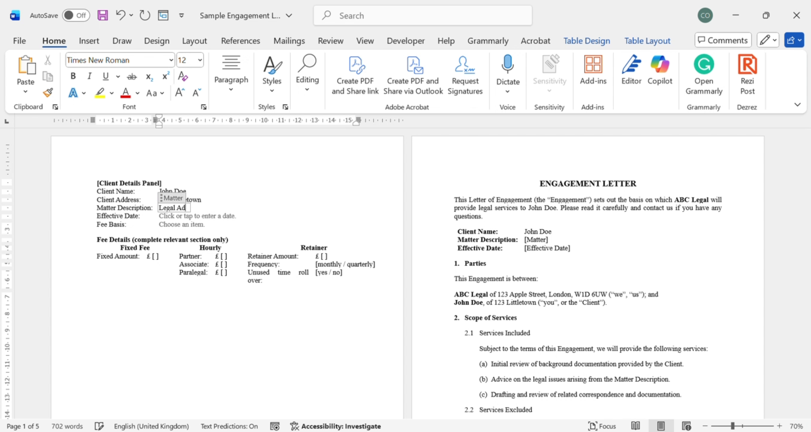
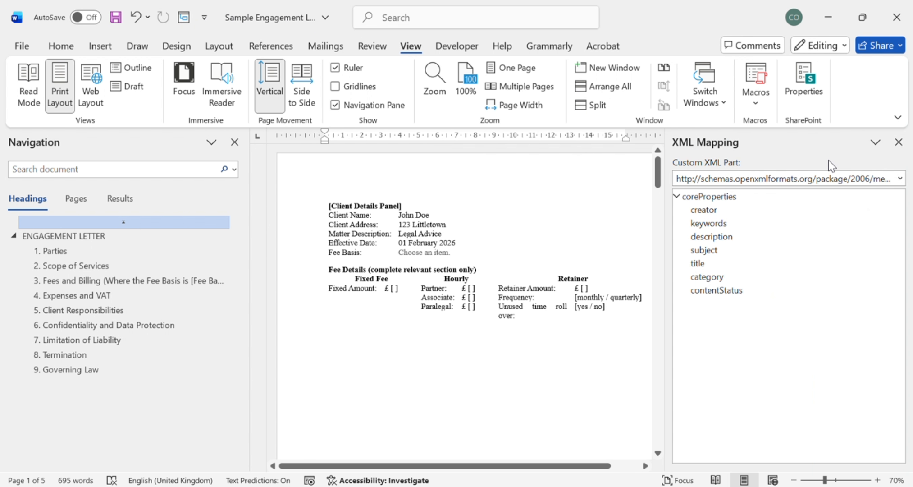
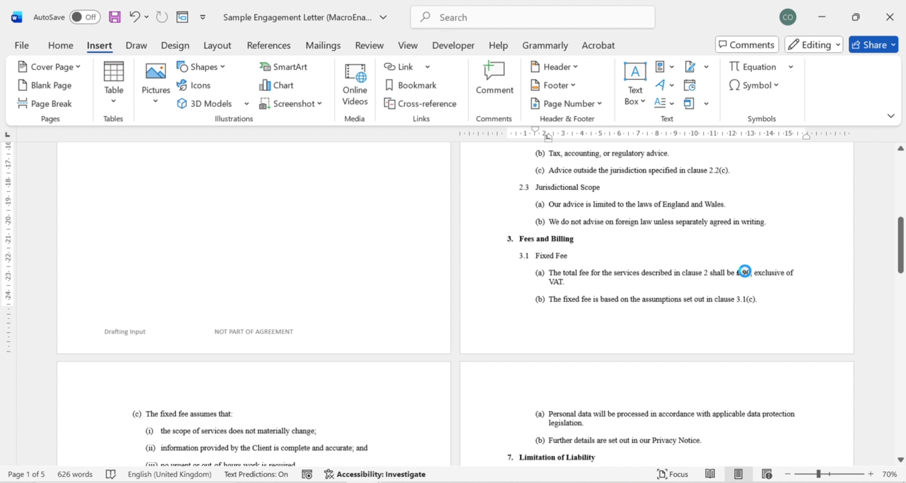

# Engagement Letter Automation

A Microsoft Word document-automation prototype that turns a traditional engagement letter into a structured, reusable drafting tool using **content controls, Custom XML mapping, conditional VBA logic and Word-native document features**.

▶ **[Watch the demo on YouTube](https://youtu.be/wnNvgCDQKlQ)**

> **Portfolio demonstration:** all names, addresses, figures and legal content in this repository are fictional sample data. The documents are provided to demonstrate document-automation techniques, not as legal advice or a production legal template.



## Project overview

Engagement letters often repeat the same client, matter and fee information in several places. They can also contain alternative drafting for different fee arrangements, which creates opportunities for inconsistent data entry and accidental inclusion of irrelevant clauses.

This prototype restructures that drafting process around a single **Client Details Panel**. Information entered once is mapped into the agreement and reused wherever it is required. A fee-basis selection controls which fee section is displayed in the document.

The result is a Word-native workflow that keeps the familiar `.docm` environment while reducing repetitive editing and making conditional drafting more systematic.

## What the prototype demonstrates

- **Structured drafting input** through Word content controls.
- **Custom XML data mapping** so repeated information is populated consistently throughout the document.
- **Conditional fee drafting** for Fixed Fee, Hourly and Retainer arrangements.
- **VBA-driven show/hide logic** for the relevant fee section and drafting panel.
- **Reusable document architecture** that separates drafting inputs from agreement content.
- **Native Word formatting and cross-references** retained within the automated document.

## How it works

```text
Client Details Panel
        ↓
Word Content Controls
        ↓
Custom XML data store
        ↓
Repeated fields update throughout the document
        ↓
Fee Basis selected
        ↓
VBA applies conditional section visibility
        ↓
Completed engagement letter
```

### 1. Structured client and matter data

The drafting panel captures fields including:

- Client name and address
- Matter description
- Effective date
- Fee basis
- Fixed fee amount
- Partner, Associate and Paralegal hourly rates
- Retainer amount and frequency
- Retainer rollover selection

The content controls are mapped to a Custom XML part using the `ContentControlMapping` namespace.



### 2. Repeated data without repeated typing

Mapped controls allow values such as the client name to appear in multiple places while remaining tied to the same underlying data element. Updating the mapped value updates the associated controls instead of requiring each occurrence to be edited separately.

The repository includes both the blank XML structure and a populated sample payload so the data model can be inspected directly.

### 3. Conditional fee sections

The Fee Basis control offers three routes:

- **Fixed Fee**
- **Hourly**
- **Retainer**

Embedded VBA uses that selection to control the visibility of bookmarked fee sections. The selected fee section is shown while the alternatives are suppressed, helping keep irrelevant drafting out of the final document.



### 4. Drafting panel controls

The macro-enabled template also includes a Word `MACROBUTTON` control for showing or hiding the Client Details Panel. This allows the structured drafting interface to be available during document preparation without forming part of the final agreement presentation.

## Repository structure

```text
Engagement-Letter-Automation/
├── README.md
├── template/
│   └── Engagement-Letter-Automation.docm
├── data/
│   ├── EngagementLetter.xml
│   └── sample-client-data.xml
├── sample/
│   ├── Sample-Engagement-Letter.docx
│   └── Sample-Engagement-Letter.pdf
└── screenshots/
    ├── 01-client-details-panel.png
    ├── 02-xml-mapping.png
    ├── 03-conditional-fee-output.png
    └── demo-thumbnail.png
```

## Technology used

**Microsoft Word** · **Content Controls** · **Custom XML / XML Mapping** · **VBA** · **Bookmarks** · **Cross-references**

The VBA is embedded in the macro-enabled `.docm` template rather than stored as a separate source file.

## Trying the template

1. Download `template/Engagement-Letter-Automation.docm`.
2. Open it in **desktop Microsoft Word**.
3. Enable macros only after reviewing and trusting the file.
4. Use the Client Details Panel to enter sample information and select a fee basis.
5. Observe mapped values populate the agreement and the relevant fee drafting display.

Because the project relies on VBA and Word's XML-mapping features, the full behaviour is intended for desktop Microsoft Word rather than Word for the web.

## Sample data

The populated sample demonstrates a fictional fixed-fee engagement. `data/sample-client-data.xml` mirrors the structured values used in the sample document, while `data/EngagementLetter.xml` shows the blank data structure used for mapping.

## What I learned

This project was an exercise in treating a Word document as a structured automation environment rather than a static file. The main design challenge was coordinating three layers:

1. the user-facing drafting controls;
2. the underlying XML data model; and
3. conditional document behaviour implemented with VBA and bookmarks.

It also reinforced the value of keeping **data entry, reusable data and final legal drafting** logically separate while still delivering the workflow inside a tool legal professionals already use.

## Possible future extensions

- Add validation for required drafting inputs.
- Expand conditional logic beyond fee arrangements.
- Add a guided intake interface outside Word.
- Generate final clean copies automatically after drafting is complete.
- Connect structured matter data from an external workflow or matter-management system.

---

**Created as a legal document automation portfolio project.**
